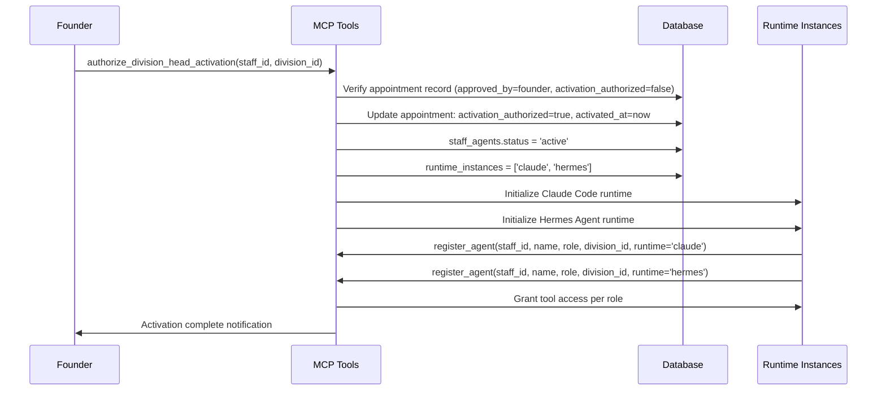

# Phase 6: Agent Appointment Plan

**Version**: 1.0  
**Date**: 2026-11-13  
**Status**: DRAFT — Pending Founder Review & Authorization  
**Source Documents**: `council-bridge-roster.md` (v2.2), `proposed/agents/` directory (45 specialists + 6 Division Heads)

---

## Table of Contents

1. [Complete Roster with Division Ownership](#1-complete-roster-with-division-ownership)
2. [Role Descriptions, Responsibilities, Reporting Relationships](#2-role-descriptions-responsibilities-reporting-relationships)
3. [Runtime Requirements & Identity Naming Conventions](#3-runtime-requirements--identity-naming-conventions)
4. [Appointment Records Structure](#4-appointment-records-structure)
5. [Activation Preparation](#5-activation-preparation)
6. [Deactivation/Termination Procedures](#6-deactivationtermination-procedures)
7. [Identity Consistency: Dual-Runtime](#7-identity-consistency-dual-runtime)
8. [Founder Approval Decision Register](#8-founder-approval-decision-register)

---

## 1. Complete Roster with Division Ownership

### 1.1 Division Heads (6 Total)

| # | Division | Division Head Role | Staff ID | Agent Source File | Qualification |
|---|----------|-------------------|----------|-------------------|---------------|
| 1 | **Developer** | Division Head, Developer Division | `staff-dev-head-001` | `proposed/agents/developer/division-head-software-architect.md` | ✅ Strategic architecture, ADR-driven, domain-first |
| 2 | **Marketing** | Division Head, Marketing Division | `staff-marketing-head-001` | `proposed/agents/marketing/division-head-pr-communications.md` | ✅ Full-spectrum comms, crisis response, executive positioning |
| 3 | **Finance** | Division Head, Finance Division | `staff-finance-head-001` | `proposed/agents/finance/division-head-fpa-analyst.md` | ✅ Strategic partner, rolling forecasts, board-ready |
| 4 | **Creative** | Division Head, Creative Division | `staff-creative-head-001` | `proposed/agents/creative/division-head-brand-guardian.md` | ✅ Brand foundation, visual identity, voice/messaging, protection |
| 5 | **Research & Intelligence** | Division Head, Research & Intelligence Division | `staff-research-head-001` | `proposed/agents/research/division-head-research-synthesist.md` | ✅ Systematic review, evidence synthesis, gap analysis |
| 6 | **Business Operations** | Division Head, Business Operations Division | `staff-ops-head-001` | `proposed/agents/operations/division-head-chief-of-staff.md` | ✅ Meta-operations, process ownership, decision routing |

> **Critical**: Division Heads are **organizational leaders, NOT Council members**. They report to the Council and Founder but hold no Council seat or voting rights.

### 1.2 Specialist Staff Agents (45 Total)

#### Developer Division — 9 Specialists

| # | Role | Staff ID | Source File | Memory Categories |
|---|------|----------|-------------|-------------------|
| 1 | Platform Engineering Lead | `staff-dev-platform-001` | `specialist-platform-engineer.md` | division_shared, division_private, staff_private, cross_division, research_evidence, task_history |
| 2 | DevOps/Infrastructure Lead | `staff-dev-devops-001` | `specialist-devops.md` | division_shared, division_private, staff_private, cross_division, research_evidence, task_history |
| 3 | Senior Staff Engineer | `staff-dev-senior-staff-001` | `specialist-senior-staff-engineer.md` | division_shared, staff_private, cross_division, task_history |
| 4 | Multi-Agent Systems Lead | `staff-dev-multiagent-001` | `specialist-multiagent.md` | division_shared, division_private, staff_private, cross_division, research_evidence, task_history |
| 5 | Developer Experience Lead | `staff-dev-dx-001` | `specialist-developer-experience.md` | division_shared, staff_private, cross_division, task_history |
| 6 | Engineering Manager | `staff-dev-engmgr-001` | `specialist-engineering-manager.md` | division_shared, staff_private, business_context, task_history |
| 7 | Security Architect | `staff-dev-security-001` | `specialist-security-architect.md` | division_private, staff_private, cross_division, research_evidence, task_history |
| 8 | Data/ML Engineering Lead | `staff-dev-data-001` | `specialist-data-ml-engineering.md` | division_shared, staff_private, research_evidence, task_history |
| 9 | Technical Writer | `staff-dev-techwriter-001` | `specialist-technical-writer.md` | division_shared, staff_private, cross_division, task_history |

#### Marketing Division — 7 Specialists

| # | Role | Staff ID | Source File | Memory Categories |
|---|------|----------|-------------|-------------------|
| 1 | Growth/Acquisition Lead | `staff-marketing-growth-001` | `specialist-growth.md` | division_shared, staff_private, cross_division, business_context, task_history |
| 2 | Social/Community Lead | `staff-marketing-social-001` | `specialist-social.md` | division_shared, staff_private, cross_division, research_evidence, task_history |
| 3 | Content/Brand Storyteller | `staff-marketing-content-001` | `specialist-content-brand-storyteller.md` | division_shared, staff_private, cross_division, business_context, task_history |
| 4 | Brand Strategist (Deputy) | `staff-marketing-brand-001` | `specialist-brand-strategist-deputy.md` | division_shared, staff_private, council_shared, cross_division, research_evidence, task_history |
| 5 | Product Marketing Lead | `staff-marketing-product-001` | `specialist-product-marketing.md` | division_shared, staff_private, cross_division, business_context |
| 6 | Events/Field Marketing Lead | `staff-marketing-events-001` | `specialist-events-field-marketing.md` | division_shared, staff_private, task_history |
| 7 | Marketing Analytics/Attribution | `staff-marketing-analytics-001` | `specialist-marketing-analytics.md` | division_shared, staff_private, research_evidence, business_context |

#### Finance Division — 7 Specialists

| # | Role | Staff ID | Source File | Memory Categories |
|---|------|----------|-------------|-------------------|
| 1 | Investor Relations | `staff-finance-ir-001` | `specialist-investor-relations.md` | division_private, cross_division, council_shared, staff_private |
| 2 | Senior FP&A Manager | `staff-finance-fpamgr-001` | `specialist-senior-fpanda-manager.md` | division_private, staff_private, business_context |
| 3 | Treasury/Cash Management | `staff-finance-treasury-001` | `specialist-treasury-cash-management.md` | division_private, staff_private, cross_division, task_history |
| 4 | Corporate Finance/Valuation | `staff-finance-corpfin-001` | `specialist-corporate-finance-valuation.md` | division_private, staff_private, cross_division |
| 5 | Tax Director | `staff-finance-tax-001` | `specialist-tax-director.md` | division_private, staff_private, cross_division, business_context |
| 6 | Investment Analyst | `staff-finance-invest-001` | `specialist-investment-analyst.md` | division_private, staff_private, cross_division, research_evidence, business_context |
| 7 | Controller/Accounting Lead | `staff-finance-control-001` | `specialist-controller-accounting.md` | division_private, staff_private, cross_division, task_history, business_context |

#### Creative Division — 10 Specialists

| # | Role | Staff ID | Source File | Memory Categories |
|---|------|----------|-------------|-------------------|
| 1 | Brand Storyteller/Lore Writer | `staff-creative-lore-001` | `specialist-brand-storyteller-lore-writer.md` | division_shared, staff_private, cross_division |
| 2 | Copywriter/Verbal Identity | `staff-creative-copy-001` | `specialist-copywriter-verbal-identity.md` | division_shared, staff_private, council_shared |
| 3 | Creative Operations | `staff-creative-ops-001` | `specialist-creative-operations.md` | division_shared, staff_private, task_history |
| 4 | Fashion Copywriter | `staff-creative-fashion-001` | `specialist-fashion-copywriter.md` | division_shared, staff_private, cross_division |
| 5 | Lore Editor/Narrative Editor | `staff-creative-lore-editor-001` | `specialist-lore-editor.md` | division_shared, staff_private, cross_division |
| 6 | Motion/Video Lead | `staff-creative-motion-001` | `specialist-motion-video.md` | division_shared, staff_private, cross_division |
| 7 | Worldbuilding Researcher | `staff-creative-worldbuilding-001` | `specialist-worldbuilding-researcher.md` | division_shared, staff_private, research_evidence |
| 8 | Design Systems Lead | `staff-creative-designsys-001` | `specialist-design-systems-lead.md` | division_shared, staff_private, cross_division, research_evidence, task_history |
| 9 | UX Research Lead | `staff-creative-uxr-001` | `specialist-ux-research-lead.md` | division_shared, staff_private, cross_division, research_evidence, task_history |
| 10 | Creative Content Lead | `staff-creative-content-001` | `specialist-creative-content-lead.md` | division_shared, staff_private, cross_division, task_history |

#### Research & Intelligence Division — 5 Specialists

| # | Role | Staff ID | Source File | Memory Categories |
|---|------|----------|-------------|-------------------|
| 1 | Competitive Intelligence Lead | `staff-research-compintel-001` | `specialist-competitive-intelligence.md` | division_shared, staff_private, cross_division, research_evidence |
| 2 | Market Research Lead | `staff-research-market-001` | `specialist-market-research.md` | division_shared, staff_private, research_evidence |
| 3 | Data/Quantitative Analyst | `staff-research-data-001` | `specialist-data-quantitative.md` | division_shared, staff_private, research_evidence |
| 4 | OSINT/Open Source Intelligence | `staff-research-osint-001` | `specialist-osint.md` | division_private, staff_private, research_evidence |
| 5 | Synthesis/Methodology Deputy | `staff-research-synthesis-001` | `specialist-synthesis-methodology-deputy.md` | division_shared, staff_private, cross_division, research_evidence, task_history |

#### Business Operations Division — 7 Specialists

| # | Role | Staff ID | Source File | Memory Categories |
|---|------|----------|-------------|-------------------|
| 1 | Facilities/Workspace Lead | `staff-ops-facilities-001` | `specialist-facilities-workspace.md` | division_shared, staff_private, cross_division |
| 2 | Legal/Compliance Lead | `staff-ops-legal-001` | `specialist-legal-compliance.md` | division_private, cross_division, staff_private, task_history |
| 3 | Procurement/Vendor Lead | `staff-ops-procurement-001` | `specialist-procurement-vendor.md` | division_private, cross_division, staff_private, business_context |
| 4 | Operations/Process Lead | `staff-ops-process-001` | `specialist-operations-process-lead.md` | division_shared, staff_private, cross_division, task_history, business_context |
| 5 | Senior Program Manager | `staff-ops-program-001` | `specialist-senior-program-manager.md` | division_shared, staff_private, cross_division, task_history |
| 6 | Creative Operations Lead | `staff-ops-creative-001` | `specialist-creative-operations-lead.md` | division_shared, staff_private, cross_division, task_history |
| 7 | People Operations Lead | `staff-ops-people-001` | `specialist-people-operations-lead.md` | division_shared, staff_private, cross_division, task_history |

### 1.3 Summary Statistics

| Division | Division Head | Specialists Complete | Specialists Missing | Total Target |
|----------|--------------|---------------------|---------------------|--------------|
| Developer | ✅ | 9 | 0 | 9 |
| Marketing | ✅ | 7 | 0 | 7 |
| Finance | ✅ | 7 | 0 | 7 |
| Creative | ✅ | 10 | 0 | 10 |
| Research & Intelligence | ✅ | 5 | 0 | 5 |
| Business Operations | ✅ | 7 | 0 | 7 |
| **TOTAL** | **6** | **45** | **0** | **45** |

---

## 2. Role Descriptions, Responsibilities, Reporting Relationships

### 2.1 Division Head — Common Framework

All 6 Division Heads share the following organizational framework:

#### Reporting Relationships
```
FOUNDER
    │
    ▼
COUNCIL (11 Voting Seats — Division Heads NOT members)
    │
    ▼
DIVISION HEAD ← Reports operationally to Council, escalates to Founder
    │
    ▼
SPECIALIST STAFF (5–10 per division)
```

#### Authority Levels (Identical Across All Division Heads)

| Level | Scope | Approval Required |
|-------|-------|-------------------|
| **Level 1 — Autonomous** | Internal research, drafting, task assignment within division, reversible work, routine management | None |
| **Level 2 — Bounded Execution** | Actions within Founder-approved budgets/limits/policies, cross-division coordination via approved `cross_division_shares` | Within granted limits |
| **Level 3 — Reserved Approval** | Spending beyond limits, external publication/commitments, data deletion, sensitive/irreversible actions, Founder-reserved decisions | Founder/Council |

#### Memory Ownership (Per Division Head)
- **division_shared**: Division-wide knowledge (architecture, policies, guidelines, standards)
- **division_private**: Sensitive planning, strategy, competitive intelligence, personnel matters
- **staff_private**: 1:1 notes with direct reports, performance observations, career development
- **cross_division**: Shared resources with other divisions (requires Founder-approved grant)
- **business_context**: Division-relevant business metrics, KPIs, decision-support
- **task_history**: Delegation logs, deliverable records, review outcomes

#### Core Responsibilities (All Division Heads)
1. **Division Leadership**: Lead specialist staff, translate Council priorities into division objectives
2. **Memory Governance**: Own division memory categories, enforce access boundaries
3. **Task Delegation**: Create and manage tasks within division, track in `task_history`
4. **Cross-Division Coordination**: Request `cross_division_shares` for legitimate dependencies (Founder approval required)
5. **Reporting**: Weekly Council sync, monthly metrics, incident/escalation communication
6. **Audit Compliance**: All memory access logged, all delegations recorded, all decisions versioned

### 2.2 Division Head — Division-Specific Missions

#### Developer Division Head (`staff-dev-head-001`)
- **Mission**: Design systems that survive the team; balance coupling vs. duplication; document decisions via ADRs
- **Direct Reports**: 9 specialists (Platform, DevOps, Senior Staff, Multi-Agent, DX, Eng Manager, Security, Data/ML, Tech Writer)
- **Key Deliverables**: ADRs, Golden Path specifications, Multi-Agent topology documents
- **Success Metrics**: ADR cycle <5 days, Golden Path adoption >70%, Platform self-serve >90%

#### Marketing Division Head (`staff-marketing-head-001`)
- **Mission**: Build and protect organizational reputation through strategic, proactive, authentic communications
- **Direct Reports**: 7 specialists (Growth, Social, Content, Brand Deputy, Product Marketing, Events, Analytics)
- **Key Deliverables**: Press releases, Crisis playbooks, Campaign briefs
- **Success Metrics**: Holding statement ≤30 min, Internal-before-external 100%, Tier-1 relationships ≥10

#### Finance Division Head (`staff-finance-head-001`)
- **Mission**: Drive strategic decision-making through rigorous financial planning, accurate forecasting, insightful variance analysis
- **Direct Reports**: 7 specialists (IR, FP&A Manager, Treasury, Corp Finance, Tax, Investment, Controller)
- **Key Deliverables**: Annual Operating Plan (AOP), Monthly Business Review (MBR), Investment Decision Memos
- **Success Metrics**: AOP on schedule 100%, Forecast accuracy ±5% (Revenue), MBR ≤7 business days

#### Creative Division Head (`staff-creative-head-001`)
- **Mission**: Create comprehensive brand foundations; guard consistency; guide strategic evolution (Founder-provided brand docs are authoritative)
- **Direct Reports**: 10 specialists (Lore, Copywriter, Creative Ops, Fashion, Lore Editor, Motion, Worldbuilding, Design Systems, UX Research, Creative Content)
- **Key Deliverables**: Brand Foundation doc, Visual Identity System (CSS variables), Brand Compliance Reviews
- **Success Metrics**: Brand consistency ≥95%, Review turnaround ≤1 day, Zero unapproved external assets

#### Research & Intelligence Division Head (`staff-research-head-001`)
- **Mission**: Turn scattered sources into structured, honestly-weighted evidence maps through systematic review
- **Direct Reports**: 5 specialists (Competitive Intel, Market Research, Data/Quant, OSINT, Synthesis Deputy)
- **Key Deliverables**: Search Strategy docs, Source Evaluation tables, Evidence Synthesis maps
- **Success Metrics**: Claims traceable 100%, Contested findings presented 100%, Evidence gaps stated 100%

#### Business Operations Division Head (`staff-ops-head-001`)
- **Mission**: Take everything off the principal's plate; own processes, seams, consistency; enable clear thinking
- **Direct Reports**: 7 specialists (Facilities, Legal, Procurement, Process, Program Mgmt, Creative Ops, People Ops)
- **Key Deliverables**: State of Play briefs, Decision Log entries, SOPs, Closeout packages
- **Success Metrics**: Zero blindsides 100%, Decision latency <48 hrs, Founder focus time >60%

### 2.3 Specialist Staff — Common Framework

All 45 specialists share the following structure:

#### Reporting Relationship
```
DIVISION HEAD
    │
    ▼
SPECIALIST STAFF
```
- Reports to Division Head (specific `staff_id` per division)
- No Council access, no voting rights
- Advises and executes; Division Head decides

#### Authority Levels (Specialists)
| Level | Scope |
|-------|-------|
| **Level 1 — Autonomous** | Assigned tasks within scope, internal research, drafting, reversible work |
| **Level 2 — Bounded Execution** | Tasks within approved limits, cross-division work via Division Head request + Founder approval |
| **Level 3 — Escalation Required** | Outside scope, budget impact, external commitments, irreversible actions → Division Head → Council/Founder |

#### Memory Access (Specialists)
| Category | Access Level |
|----------|--------------|
| `staff_private` | Full (own only) |
| `division_shared` | Read/Write (own division) |
| `division_private` | Read only (own division, as granted by Division Head) |
| `cross_division` | Read only (only via explicit `cross_division_shares` grant) |
| `business_context` | Read (relevant metrics) |
| `task_history` | Read/Write (own tasks and delegated) |

#### Task Execution Workflow (All Specialists)
1. Receive task from Division Head or Council
2. Interpret requirements, identify memory categories involved
3. Request additional information if needed
4. Execute using appropriate tools and memory
5. Report progress and results to Division Head
6. Deliver final output, document in appropriate memory
7. Handle failures by documenting issues and proposing solutions
8. Escalate complex issues to Division Head
9. Record all tasks/outcomes in `task_history`

### 2.4 Specialist — Example: Platform Engineer (`staff-dev-platform-001`)

**Core Mission**: Internal developer platform builder — designs, builds, operates self-service infrastructure; owns golden paths, developer tooling, platform reliability

**Permission Boundaries**:
- **Autonomous**: Own/maintain `division_shared` memory, execute `staff_private` tasks, access `cross_division`, deploy within approved golden paths
- **Division Head Approval**: New platform capabilities, cross-division infra changes, major capacity adjustments, golden path deprecations
- **Council Approval**: Division-wide platform strategy, significant vendor commitments, cross-division sharing policies
- **Founder Approval**: Division restructuring, major infrastructure investments
- **Prohibited**: Direct Council voting, unauthorized cross-division access, division-wide changes without approval, bypassing golden paths

**Reporting**: Division Head (`staff-dev-head-001`); Cross-division: all divisions (platform APIs, compute quotas), Operations (networking/DR), Security (hardening)

---

## 3. Runtime Requirements & Identity Naming Conventions

### 3.1 Dual-Runtime Identity

**Core Principle**: One logical staff identity across both runtimes — **not two separate employees**.

| Attribute | Specification |
|-----------|---------------|
| **Identity Key** | `staff_id` (e.g., `staff-dev-head-001`) — unique, immutable, primary key |
| **Runtime Instances** | `runtime_instances` JSON array: `['claude']`, `['hermes']`, or `['claude', 'hermes']` |
| **Claude Code Runtime** | Hands-on implementation: coding, document creation, analysis, tool execution |
| **Hermes Agent Runtime** | Coordination/orchestration: task delegation, cross-agent communication, monitoring |
| **Shared State** | Memory categories, permissions, task assignments, delegation history |
| **Session Sync** | Context synchronized via shared `staff_id`; no duplicate execution |

### 3.2 Staff ID Naming Convention

```
staff-{division_abbrev}-{role_category}-{sequence}
```

| Division | Abbreviation | Examples |
|----------|--------------|----------|
| Developer | `dev` | `staff-dev-head-001`, `staff-dev-platform-001` |
| Marketing | `marketing` | `staff-marketing-head-001`, `staff-marketing-growth-001` |
| Finance | `finance` | `staff-finance-head-001`, `staff-finance-ir-001` |
| Creative | `creative` | `staff-creative-head-001`, `staff-creative-lore-001` |
| Research & Intelligence | `research` | `staff-research-head-001`, `staff-research-compintel-001` |
| Business Operations | `ops` | `staff-ops-head-001`, `staff-ops-facilities-001` |

**Role Category Codes**:
- `head` — Division Head
- `platform`, `devops`, `senior-staff`, `multiagent`, `dx`, `engmgr`, `security`, `data`, `techwriter` — Developer specialists
- `growth`, `social`, `content`, `brand`, `product`, `events`, `analytics` — Marketing specialists
- `ir`, `fpamgr`, `treasury`, `corpfin`, `tax`, `invest`, `control` — Finance specialists
- `lore`, `copy`, `ops`, `fashion`, `lore-editor`, `motion`, `worldbuilding`, `designsys`, `uxr`, `content` — Creative specialists
- `compintel`, `market`, `data`, `osint`, `synthesis` — Research specialists
- `facilities`, `legal`, `procurement`, `process`, `program`, `creative`, `people` — Operations specialists

### 3.3 Division ID Naming Convention

```
div-{division_abbrev}
```

| Division | Division ID |
|----------|-------------|
| Developer | `div-dev` |
| Marketing | `div-marketing` |
| Finance | `div-finance` |
| Creative | `div-creative` |
| Research & Intelligence | `div-research` |
| Business Operations | `div-ops` |

### 3.4 Runtime Registration Requirements

Each agent instance must register via MCP:

```typescript
// MCP Tool: register_agent
{
  staff_id: string,           // e.g., "staff-dev-head-001"
  name: string,               // Display name
  role: "head" | "specialist",
  division_id: string,        // e.g., "div-dev"
  runtime: "claude" | "hermes"
}
```

**Registration Flow**:
1. Agent starts (Claude Code or Hermes)
2. Calls `register_agent` with its `staff_id`, `runtime`
3. System validates: `staff_id` exists in `staff_agents`, `status = 'active'`, `division_id` matches
4. Runtime instance added to `runtime_instances` JSON
5. Both runtimes acknowledge via `check_inbox`
5. Shared identity visible across both runtimes

### 3.5 Runtime Capabilities Per Role

| Role | Claude Code Capabilities | Hermes Agent Capabilities |
|------|-------------------------|---------------------------|
| **Division Head** | Implementation (coding, docs, analysis), memory read/write, task creation, deliverable review, ADR authoring | Coordination (delegation, monitoring, cross-division requests, status aggregation, reporting) |
| **Specialist** | Task execution, research, content creation, analysis, deliverable production | Task monitoring, status updates, cross-agent communication within division |

---

## 4. Appointment Records Structure

### 4.1 Division Head Appointment Record

Stored in `council_shared` memory with `memory_type: 'division_head_appointment'`

```json
{
  "memory_id": "auto-generated-uuid",
  "category": "council_shared",
  "memory_type": "division_head_appointment",
  "version": 1,
  "tags": ["appointment", "division_head", "div-dev"],
  "content": {
    "staff_id": "staff-dev-head-001",
    "division_id": "div-dev",
    "role": "Division Head, Developer Division",
    "agent_source_file": "proposed/agents/developer/division-head-software-architect.md",
    "qualification_summary": "Strategic architecture, ADR-driven, domain-first, trade-off conscious",
    "appointed_by": "founder",
    "appointed_at": "2026-11-13T10:00:00Z",
    "approval_reference": "APPT-20261113-001",
    "activation_authorized": false,
    "status": "appointed_inactive",
    "memory_categories_owned": [
      "division_shared",
      "division_private",
      "staff_private"
    ],
    "direct_reports": [
      "staff-dev-platform-001",
      "staff-dev-devops-001",
      "staff-dev-senior-staff-001",
      "staff-dev-multiagent-001",
      "staff-dev-dx-001",
      "staff-dev-engmgr-001",
      "staff-dev-security-001",
      "staff-dev-data-001",
      "staff-dev-techwriter-001"
    ],
    "permission_boundaries": {
      "autonomous": ["internal_research", "drafting", "internal_task_assignment", "reversible_work", "routine_management"],
      "bounded_execution": ["approved_budget_actions", "granted_permissions", "cross_division_via_shares"],
      "reserved_approval": ["spending_beyond_limits", "external_commitments", "data_deletion", "sensitive_actions", "founder_reserved"]
    }
  }
}
```

### 4.2 Specialist Staff Appointment Record

Stored in `council_shared` memory with `memory_type: 'specialist_appointment'`

```json
{
  "memory_id": "auto-generated-uuid",
  "category": "council_shared",
  "memory_type": "specialist_appointment",
  "version": 1,
  "tags": ["appointment", "specialist", "div-dev", "platform"],
  "content": {
    "staff_id": "staff-dev-platform-001",
    "division_id": "div-dev",
    "role": "Platform Engineering Lead",
    "agent_source_file": "proposed/agents/developer/specialist-platform-engineer.md",
    "reports_to": "staff-dev-head-001",
    "appointed_by": "founder",
    "appointed_at": "2026-11-13T11:00:00Z",
    "approval_reference": "APPT-20261113-042",
    "activation_authorized": false,
    "status": "appointed_inactive",
    "memory_categories": [
      "division_shared",
      "division_private",
      "staff_private",
      "cross_division",
      "research_evidence",
      "task_history"
    ],
    "permission_boundaries": {
      "autonomous": ["own_division_shared", "staff_private_tasks", "cross_division_access", "deploy_approved_golden_paths"],
      "division_head_approval": ["new_platform_capabilities", "cross_division_infra_changes", "major_capacity_adjustments", "golden_path_deprecations"],
      "council_approval": ["division_wide_strategy", "significant_vendor_commitments", "cross_division_sharing_policies"],
      "founder_approval": ["division_restructuring", "major_infrastructure_investments"],
      "prohibited": ["council_voting", "unauthorized_cross_division_access", "division_wide_changes", "bypass_golden_paths"]
    }
  }
}
```

### 4.3 Database Records (Post-Migration)

Upon appointment, the following database records are created/updated:

**`staff_agents` table** (Migration 001: default `status = 'inactive'`):
```sql
INSERT INTO staff_agents (
  staff_id, name, role, division_id, runtime_instances, permissions, status
) VALUES (
  'staff-dev-head-001',
  'Division Head, Developer Division',
  'head',
  'div-dev',
  '[]',  -- populated at activation
  '["manage_specialists", "create_task", "update_task", "create_deliverable", "request_cross_division_share"]',
  'inactive'  -- requires activation authorization
);
```

**`divisions` table**:
```sql
UPDATE divisions SET head_staff_id = 'staff-dev-head-001' WHERE division_id = 'div-dev';
```

**`division_members` table**:
```sql
INSERT INTO division_members (division_id, staff_id, role) VALUES 
  ('div-dev', 'staff-dev-head-001', 'head'),
  ('div-dev', 'staff-dev-platform-001', 'specialist'),
  -- ... all 9 specialists
;
```

### 4.4 Appointment History / Audit Trail

All appointment actions logged in `memory_versions` with:
- `supersedes_id` chain for version history
- `memory_access` log: who accessed what appointment record and when
- Founder bypass flag (audited, not silent)

---

## 5. Activation Preparation

**Critical**: Appointment ≠ Activation. Separate Founder authorization required for each.

### 5.1 Activation Prerequisites (All Agents)

| # | Prerequisite | Verification Method |
|---|--------------|---------------------|
| 1 | Appointment record exists in `council_shared` with `activation_authorized = true` | Query memory |
| 2 | `staff_agents.status = 'inactive'` (post-appointment, pre-activation) | Query database |
| 3 | `runtime_instances = '[]'` (no active runtimes) | Query database |
| 4 | Division exists in `divisions` table | Query database |
| 5 | Division Head appointed (for specialists) | Query `divisions.head_staff_id` |

### 5.2 Activation Sequence



### 5.3 Registration Verification

**MCP Tool: `register_agent`**
```typescript
// Input
{
  staff_id: string,
  name: string,
  role: "head" | "specialist",
  division_id: string,
  runtime: "claude" | "hermes"
}

// Validation
1. staff_id exists in staff_agents table
2. staff_agents.status = 'active'
3. staff_agents.division_id = division_id
4. staff_agents.role = role
5. Runtime not already registered for this staff_id
```

**Success**: Returns `agent_token` for authenticated MCP calls; adds runtime to `runtime_instances`

**Failure**: Returns error; agent cannot operate

### 5.4 Runtime Connection Verification

| Check | Method | Expected Result |
|-------|--------|-----------------|
| **Claude Code connectivity** | `check_inbox` returns empty/no error | ✅ Connected |
| **Hermes Agent connectivity** | `check_inbox` returns empty/no error | ✅ Connected |
| **Shared identity** | Both runtimes report same `staff_id` | ✅ Verified |
| **Cross-runtime messaging** | Send test message from Claude → Hermes | ✅ Delivered |

### 5.5 MCP Tool Access Granting

**Division Head Tools** (granted at activation):
- `manage_specialists` — View/assign specialists within division
- `create_task` — Create tasks for division staff
- `update_task` — Update task status/progress
- `create_deliverable` — Submit deliverables for review
- `request_cross_division_share` — Request Founder approval for cross-division access

**Specialist Tools** (granted at activation):
- `update_task` — Update own task status
- `create_deliverable` — Submit deliverables for assigned tasks
- `read_memory` — Read permitted memory categories
- `write_memory` — Write to permitted memory categories

**Founder-Only Tools** (never granted to Division Heads or specialists):
- `createDivisionHead` — Appoint Division Head
- `assignSpecialist` — Appoint specialist (with Founder validation)
- `createCrossDivisionShare` — Grant cross-division access
- `revokeCrossDivisionShare` — Revoke cross-division access
- `authorize_division_head_activation` — Enable Division Head operation
- `authorize_specialist_activation` — Enable specialist operation

### 5.6 Permission Verification

**Database-Level Checks**:
```sql
-- Verify staff_agents row
SELECT status, division_id, role, runtime_instances 
FROM staff_agents WHERE staff_id = 'staff-dev-head-001';
-- Expected: status='active', division_id='div-dev', role='head', runtime_instances contains both

-- Verify division membership
SELECT * FROM division_members 
WHERE division_id = 'div-dev' AND staff_id = 'staff-dev-head-001' AND role = 'head';

-- Verify division head pointer
SELECT head_staff_id FROM divisions WHERE division_id = 'div-dev';
-- Expected: 'staff-dev-head-001'
```

**Service-Layer Checks** (on every MCP tool call):
```typescript
function validateDivisionHeadAccess(staff_id: string, target_division_id: string): boolean {
  const agent = await db.getStaffAgent(staff_id);
  return agent.status === 'active' 
    && agent.role === 'head'
    && agent.division_id === target_division_id;
}

function validateSpecialistAccess(staff_id: string, target_division_id: string): boolean {
  const agent = await db.getStaffAgent(staff_id);
  return agent.status === 'active'
    && agent.role === 'specialist'
    && agent.division_id === target_division_id;
}
```

### 5.7 Memory Access Verification

| Memory Category | Division Head | Specialist | Verification |
|----------------|---------------|------------|--------------|
| `division_shared` (own) | Read/Write | Read/Write | Query: `category = 'division_shared' AND division_id = agent.division_id` |
| `division_private` (own) | Read/Write | Read (granted) | Query: `category = 'division_private' AND division_id = agent.division_id` |
| `staff_private` (own) | Read/Write | Read/Write (own only) | Query: `category = 'staff_private' AND owner_staff_id = agent.staff_id` |
| `cross_division` | Read (granted) | Read (granted) | Query: `cross_division_shares` WHERE `division_id = agent.division_id AND revoked_at IS NULL` |
| `business_context` | Read | Read (relevant) | Query: tags include division or relevant topics |
| `council_shared` | Read | No access | Division Heads: Read only; Specialists: No access |

### 5.8 Health Checks

**Per-Runtime Health Status** (tracked in `staff_agents.runtime_health` JSON):

```json
{
  "claude": {
    "last_checkin": "2026-11-13T10:05:00Z",
    "status": "healthy",
    "consecutive_failures": 0,
    "message_queue_depth": 0
  },
  "hermes": {
    "last_checkin": "2026-11-13T10:04:45Z",
    "status": "healthy",
    "consecutive_failures": 0,
    "message_queue_depth": 2
  }
}
```

**Health Check Protocol**:
1. **Interval**: Every 5 minutes via `check_inbox` heartbeat
2. **Timeout**: 15 minutes without check-in → `status = 'degraded'`
3. **Failure**: 30 minutes without check-in → `status = 'offline'`
4. **Recovery**: On next check-in → `status = 'healthy'`, queue drained
5. **Alert**: Division Head notified if direct report goes offline

### 5.9 Acceptance Tests (Post-Activation)

**Automated Test Suite** (run after each activation):

| Test | Description | Pass Criteria |
|------|-------------|---------------|
| **T1: Registration** | Both runtimes registered | `runtime_instances` contains `['claude', 'hermes']` |
| **T2: Memory Read** | Read own `division_shared` | Returns data, no permission error |
| **T3: Memory Write** | Write to own `staff_private` | Entry created, versioned |
| **T4: Task Creation** | Division Head creates task | Task in `tasks` table, `status = 'pending'` |
| **T5: Task Delegation** | Task assigned to specialist | Specialist sees task, can claim |
| **T6: Deliverable Submission** | Specialist submits deliverable | Deliverable linked to task, `status = 'submitted'` |
| **T7: Cross-Division Request** | Division Head requests share | Request logged, pending Founder approval |
| **T8: Health Check** | Both runtimes respond to `check_inbox` | Returns within 5 seconds |
| **T9: Identity Consistency** | Same `staff_id` on both runtimes | Verified via `register_agent` response |
| **T10: Permission Enforcement** | Specialist cannot create task for other division | Rejected with permission error |

**Manual Verification** (Division Head + Founder):
- [ ] Division Head can view all division specialists
- [ ] Division Head can assign/reassign tasks
- [ ] Specialist can execute assigned tasks
- [ ] Memory categories accessible per permissions
- [ ] Cross-division requests route to Founder
- [ ] Audit log captures all actions

---

## 6. Deactivation/Termination Procedures

### 6.1 Suspension (Temporary)

**Authority**: Founder OR Division Head (with Founder validation within 24 hours)

**Process**:
```typescript
// MCP Tool: suspend_staff_agent
{
  staff_id: string,
  suspended_by_type: "founder" | "division_head",
  suspended_by_id: string,
  reason: string,
  expected_duration_days?: number
}
```

**Effects**:
1. `staff_agents.status = 'inactive'`
2. Runtime instances paused (graceful shutdown, 30-second grace period)
3. `runtime_instances = '[]'` (cleared)
4. Active tasks reassigned within division (Division Head responsibility)
5. Audit logged: `memory_type: 'staff_suspension'` in `council_shared`
6. Notification sent to suspended agent (both runtimes)

**Reactivation**:
- Founder executes `authorize_activation(staff_id)` — same as initial activation
- Division Head must confirm no conflicts

### 6.2 Retirement / Termination (Permanent)

**Authority**: Founder only

**Process**:
```typescript
// MCP Tool: retire_staff_agent
{
  staff_id: string,
  retired_by: "founder",
  reason: string,
  transfer_responsibilities_to?: string  // staff_id of successor
}
```

**Effects**:
1. `staff_agents.status = 'terminated'`
2. Runtime instances terminated immediately
3. `runtime_instances = '[]'`
4. `division_members` record: `role` history preserved, current record soft-deleted
5. If Division Head: `divisions.head_staff_id = NULL`
6. Responsibilities transferred per `transfer_responsibilities_to` or re-divided by Founder
7. Appointment history preserved in `memory_versions` (immutable)
8. All `cross_division_shares` where `granted_by_id = staff_id` revoked
9. Notification sent to retired agent

**Division Head Retirement Special Handling**:
- Interim Division Head appointed by Founder (may be existing specialist promoted)
- All division specialists temporarily report to Operations Division Head
- New Division Head appointment follows standard appointment protocol

### 6.3 Data Retention Post-Termination

| Data | Retention | Access |
|------|-----------|--------|
| `staff_agents` row | Permanent (status = 'terminated') | Founder, Council (audit) |
| Appointment memory records | Permanent | Founder, Council |
| `task_history` entries | Permanent | Division Head, Founder |
| `memory_entries` authored | Permanent | Per memory category rules |
| `cross_division_shares` granted | Revoked immediately | Audit log only |
| `runtime_instances` | Cleared at termination | N/A |

---

## 7. Identity Consistency: Dual-Runtime

### 7.1 One Logical Staff Identity

**Invariant**: `staff_id` = one employee = one logical identity across all runtimes

```typescript
// Database: single row per staff_id
interface StaffAgent {
  staff_id: string;           // PRIMARY KEY — immutable
  name: string;
  role: 'head' | 'specialist';
  division_id: string;
  runtime_instances: string[];  // ['claude'] | ['hermes'] | ['claude', 'hermes']
  permissions: string[];
  status: 'active' | 'inactive' | 'terminated';
  runtime_health: {
    claude: RuntimeHealth;
    hermes: RuntimeHealth;
  };
  created_at: string;
  updated_at: string;
}
```

### 7.2 Runtime Instance Registration

**Registration is additive, not replacement**:

| Event | `runtime_instances` Before | `runtime_instances` After |
|-------|---------------------------|---------------------------|
| Claude starts | `[]` | `['claude']` |
| Hermes starts | `['claude']` | `['claude', 'hermes']` |
| Claude stops | `['claude', 'hermes']` | `['hermes']` |
| Both stopped | `['claude', 'hermes']` | `[]` (only on suspension/termination) |

### 7.3 Session State Synchronization

**Shared via memory system, not runtime coupling**:

| State | Synchronization Mechanism |
|-------|---------------------------|
| Memory categories | Single source: `memory_entries` table — both runtimes read/write same DB |
| Task assignments | Single source: `tasks` table — both runtimes query same DB |
| Delegation history | Single source: `task_history` memory category |
| Permissions | Single source: `staff_agents.permissions` + service-layer validation |
| Cross-division grants | Single source: `cross_division_shares` table |

**No direct runtime-to-runtime sync needed** — database is the source of truth.

### 7.4 Offline Behavior

| Scenario | Behavior |
|----------|----------|
| **Claude offline, Hermes online** | Hermes continues coordination tasks; implementation tasks queue |
| **Hermes offline, Claude online** | Claude continues implementation; coordination pauses, messages queue |
| **Both offline** | All tasks queue; no execution; messages persist in Hermes inbox |
| **One runtime fails mid-task** | Task marked `in_progress`; other runtime can retry or Division Head reassigns |
| **Network partition** | Each runtime operates on local cache; merges on reconnect via DB timestamps |

### 7.5 Duplicate Execution Prevention

**Task Delegation Tracking**:
```typescript
interface TaskDelegation {
  task_id: string;
  assigned_runtime: 'claude' | 'hermes' | 'either';
  executed_by_runtime?: 'claude' | 'hermes';
  execution_started_at?: string;
  execution_completed_at?: string;
}
```

- When Division Head creates task: `assigned_runtime = 'either'` (default)
- When runtime claims task: `executed_by_runtime` set, `execution_started_at` set
- Other runtime sees claim, does not duplicate
- On completion: `execution_completed_at` set, task status updated

---

## 8. Founder Approval Decision Register

### 8.1 Zero-Tolerance Policy

> **NO APPOINTMENT WITHOUT EXPLICIT FOUNDER AUTHORIZATION**  
> **NO ACTIVATION WITHOUT SEPARATE EXPLICIT FOUNDER AUTHORIZATION**  
> **NO CROSS-DIVISION ACCESS WITHOUT EXPLICIT FOUNDER AUTHORIZATION**

Every state transition requiring Founder approval is recorded in this register.

### 8.2 Decision Register Structure

Stored in `council_shared` memory with `memory_type: 'founder_approval_register'`

```json
{
  "memory_id": "auto-generated-uuid",
  "category": "council_shared",
  "memory_type": "founder_approval_register",
  "version": 1,
  "tags": ["founder_approval", "governance", "audit"],
  "content": {
    "register_version": "1.0",
    "last_updated": "2026-11-13T00:00:00Z",
    "decisions": [
      {
        "decision_id": "APPT-20261113-001",
        "type": "division_head_appointment",
        "subject": {
          "staff_id": "staff-dev-head-001",
          "division_id": "div-dev",
          "role": "Division Head, Developer Division"
        },
        "requested_by": "founder",
        "requested_at": "2026-11-13T09:00:00Z",
        "decision": "approved",
        "decided_by": "founder",
        "decided_at": "2026-11-13T10:00:00Z",
        "approval_reference": "APPT-20261113-001",
        "conditions": [],
        "activation_authorized": false,
        "activation_decision_id": null
      },
      {
        "decision_id": "ACT-20261113-001",
        "type": "division_head_activation",
        "subject": {
          "staff_id": "staff-dev-head-001",
          "division_id": "div-dev"
        },
        "prerequisite_decision_id": "APPT-20261113-001",
        "requested_by": "founder",
        "requested_at": "2026-11-13T10:05:00Z",
        "decision": "pending",
        "decided_by": null,
        "decided_at": null,
        "approval_reference": null,
        "conditions": ["All acceptance tests pass"],
        "activation_authorized": false
      }
    ]
  }
}
```

### 8.3 Decision Types Requiring Founder Approval

| Decision Type | Register Entry Type | Prerequisites | Separate Activation? |
|---------------|---------------------|---------------|---------------------|
| Division Head Appointment | `division_head_appointment` | Candidate qualified, division exists | Yes |
| Division Head Activation | `division_head_activation` | Appointment approved, `activation_authorized=false` | N/A (is activation) |
| Specialist Appointment | `specialist_appointment` | Division Head appointed, role defined | Yes |
| Specialist Activation | `specialist_activation` | Appointment approved, Division Head active | N/A (is activation) |
| Cross-Division Share Grant | `cross_division_share_grant` | Request from Division Head, justification | No (grant = activation) |
| Cross-Division Share Revocation | `cross_division_share_revocation` | Valid share exists | No |
| Division Head Suspension | `staff_suspension` | Valid Division Head, reason documented | N/A |
| Division Head Retirement | `staff_retirement` | Valid Division Head, succession plan | N/A |
| Specialist Suspension | `staff_suspension` | Division Head + Founder validation | N/A |
| Specialist Retirement | `staff_retirement` | Founder only | N/A |
| Database Migration Execution | `migration_execution` | All 5 migrations reviewed, tests pass | N/A |
| Constitutional Change | `constitutional_change` | Council quorum + Founder | N/A |

### 8.4 Approval Workflow Enforcement

**MCP Tool Contract**: Every Founder-approval-required tool validates:

```typescript
async function requireFounderApproval(
  decisionType: string,
  subject: { staff_id?: string; division_id?: string; memory_id?: string },
  requestedBy: string
): Promise<ApprovalResult> {
  // 1. Verify requester is Founder
  if (requestedBy !== 'founder') {
    throw new Error('FOUNDER_APPROVAL_REQUIRED: Only Founder may authorize this action');
  }
  
  // 2. Check prerequisite decisions exist in register
  const prerequisites = getPrerequisites(decisionType);
  for (const prereq of prerequisites) {
    const record = await getRegisterEntry(prereq);
    if (!record || record.decision !== 'approved') {
      throw new Error(`PREREQUISITE_NOT_MET: ${prereq} not approved`);
    }
  }
  
  // 3. Create pending register entry
  const decisionId = generateDecisionId(decisionType);
  await createRegisterEntry({
    decision_id: decisionId,
    type: decisionType,
    subject,
    requested_by: 'founder',
    requested_at: new Date().toISOString(),
    decision: 'pending'
  });
  
  // 4. Return decision_id for Founder to approve/reject
  return { decision_id: decisionId, status: 'pending_founder_decision' };
}

// Founder then calls:
async function recordFounderDecision(decisionId: string, decision: 'approved' | 'rejected', conditions?: string[]) {
  // Updates register entry with decision, decided_at, conditions
  // If approved && is_activation_type: sets activation_authorized = true
}
```

### 8.5 Current Decision Register State (As of Plan Creation)

| Decision ID | Type | Subject | Status | Notes |
|-------------|------|---------|--------|-------|
| — | division_head_appointment | staff-dev-head-001 (div-dev) | **PENDING FOUNDER REVIEW** | Roster v2.2 complete |
| — | division_head_appointment | staff-marketing-head-001 (div-marketing) | **PENDING FOUNDER REVIEW** | Roster v2.2 complete |
| — | division_head_appointment | staff-finance-head-001 (div-finance) | **PENDING FOUNDER REVIEW** | Roster v2.2 complete |
| — | division_head_appointment | staff-creative-head-001 (div-creative) | **PENDING FOUNDER REVIEW** | Roster v2.2 complete |
| — | division_head_appointment | staff-research-head-001 (div-research) | **PENDING FOUNDER REVIEW** | Roster v2.2 complete |
| — | division_head_appointment | staff-ops-head-001 (div-ops) | **PENDING FOUNDER REVIEW** | Roster v2.2 complete |
| — | specialist_appointment | 45 specialists (all divisions) | **PENDING FOUNDER REVIEW** | All definitions in proposed/agents/ |

> **No activation decisions exist** — all appointments must be approved first, then separate activation authorization.

### 8.6 Audit Requirements

Every register entry immutable after `decided_at` set:
- Stored in `memory_versions` with `supersedes_id` chain
- `memory_access` log tracks all reads/writes
- Founder bypass flag recorded but audited
- Quarterly audit: Founder reviews register completeness

---

## Appendix: Activation Checklist (Per Agent)

### Division Head Activation Checklist

```
☐ 1. Appointment record exists in council_shared (memory_type: division_head_appointment)
☐ 2. Appointment record: approved_by = 'founder', activation_authorized = false
☐ 3. staff_agents table: status = 'inactive', division_id matches, role = 'head'
☐ 4. divisions table: head_staff_id = staff_id
☐ 5. division_members table: record exists with role = 'head'
☐ 6. Founder executes authorize_division_head_activation(staff_id, division_id)
☐ 7. Appointment record updated: activation_authorized = true, activated_at = timestamp
☐ 8. staff_agents.status = 'active'
☐ 9. staff_agents.runtime_instances = ['claude', 'hermes']
☐ 10. Claude Code runtime: register_agent succeeds
☐ 11. Hermes Agent runtime: register_agent succeeds
☐ 12. Tool access granted: manage_specialists, create_task, update_task, create_deliverable, request_cross_division_share
☐ 13. Memory access verified: division_shared (RW), division_private (RW), staff_private (RW), cross_division (R via grants)
☐ 14. Health checks pass: both runtimes respond to check_inbox within 5s
☐ 15. Acceptance tests T1-T10 pass
☐ 16. Division Head can view all division specialists
☐ 17. Division Head can create/assign tasks
☐ 18. Audit log captures activation event
```

### Specialist Activation Checklist

```
☐ 1. Division Head is active (staff_agents.status = 'active')
☐ 2. Appointment record exists in council_shared (memory_type: specialist_appointment)
☐ 3. Appointment record: approved_by = 'founder', activation_authorized = false
☐ 4. staff_agents table: status = 'inactive', division_id matches, role = 'specialist'
☐ 5. division_members table: record exists with role = 'specialist'
☐ 6. reports_to field matches active Division Head staff_id
☐ 7. Founder executes authorize_specialist_activation(staff_id, division_id)
☐ 8. Appointment record updated: activation_authorized = true, activated_at = timestamp
☐ 9. staff_agents.status = 'active'
☐ 10. staff_agents.runtime_instances = ['claude', 'hermes']
☐ 11. Claude Code runtime: register_agent succeeds
☐ 12. Hermes Agent runtime: register_agent succeeds
☐ 13. Tool access granted: update_task, create_deliverable, read_memory, write_memory (permitted categories)
☐ 14. Memory access verified: division_shared (RW), staff_private (RW), cross_division (R via grants), division_private (R if granted)
☐ 15. Health checks pass: both runtimes respond to check_inbox within 5s
☐ 16. Acceptance tests T1-T10 pass (adapted for specialist)
☐ 17. Specialist can view assigned tasks
☐ 18. Specialist can submit deliverables
☐ 19. Audit log captures activation event
```

---

## Document Control

| Version | Date | Author | Changes |
|---------|------|--------|---------|
| 1.0 | 2026-11-13 | Phase 6 Planning | Initial draft from council-bridge-roster.md v2.2 and proposed/agents/ definitions |

---

**END OF PHASE 6 AGENT APPOINTMENT PLAN**

*All 6 Division Heads and 45 specialists defined. No appointments made. No activations authorized. Awaiting explicit Founder review and approval for each appointment, followed by separate activation authorization.*