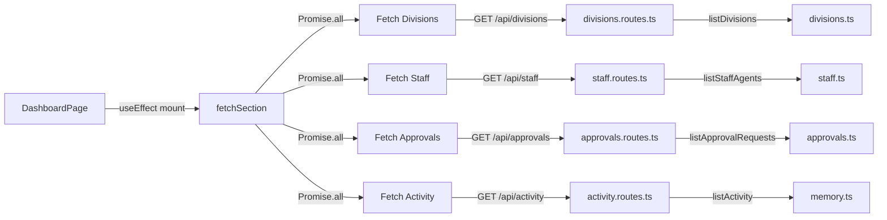

# M2/M3 Technical Architecture & UX Foundation

## Executive Summary

This document defines the technical architecture and UX foundation for M2/M3 implementation of Council Bridge. The system follows a layered architecture pattern with clear separation between:

- **API Layer**: Express.js REST endpoints with authentication middleware
- **Service Layer**: Business logic with authorization checking
- **Data Layer**: SQLite database with prepared statements
- **Frontend Layer**: React 18 + MUI with React Router

---

## Component Architecture Diagrams

### Backend Architecture (Text-Based)

```
┌─────────────────────────────────────────────────────────────────────────────┐
│                              SERVER.LS                                      │
│  Express App ── Middleware Chain ── Route Handlers ── Service Layer       │
└────────────────────────┬───────────────────────────────────────────────────┘
                         │
                         ▼
┌─────────────────────────────────────────────────────────────────────────────┐
│                        ROUTE REGISTRATION                                  │
├─────────────────────────────────────────────────────────────────────────────┤
│  /api/messages*     → MessagesRoutes     → MessageService                  │
│  /api/divisions*    → DivisionsRoutes     → DivisionService                 │
│  /api/staff*        → StaffRoutes         → StaffService                    │
│  /api/tasks*        → TasksRoutes         → TaskService                   │
│  /api/deliverables* → DeliverablesRoutes  → TaskDelegationService         │
│  /api/approvals*    → ApprovalsRoutes     → ExecutionService                │
│  /api/executions*   → ExecutionsRoutes     → ExecutionService               │
│  /api/activity      → ActivityRoutes      → MemoryService                  │
│  /mcp              → MCP Tools Handler   → Agent Runtime Bridge           │
└─────────────────────────────────────────────────────────────────────────────┘
                         │
                         ▼
┌─────────────────────────────────────────────────────────────────────────────┐
│                        AUTHENTICATION MIDDLEWARE                             │
│  Local Mode: Auto-auth as Founder (loopback only)                          │
│  Normal Mode: Validate session token, extract owner context                │
│  Production: Fail-closed, no hardcoded fallback                            │
└─────────────────────────────────────────────────────────────────────────────┘
                         │
                         ▼
┌─────────────────────────────────────────────────────────────────────────────┐
│                           DATABASE LAYER                                     │
│  SQLite (better-sqlite3) ── Prepared Statements ── WAL Journal Mode       │
└─────────────────────────────────────────────────────────────────────────────┘
```

### Frontend Architecture

```
┌─────────────────────────────────────────────────────────────────────────────┐
│                              APP.TSX                                         │
│  BrowserRouter ── Routes ── ProtectedRoute ── Layout ── Outlet              │
└────────────────────────┬───────────────────────────────────────────────────┘
                         │
         ┌───────────────┼───────────────┬───────────────┐
         ▼               ▼               ▼               ▼
┌──────────────┐ ┌──────────────┐ ┌──────────────┐ ┌──────────────┐
│  Dashboard   │ │    Chat      │ │ Organization │ │     ...      │
│  Pages       │ │  Pages       │ │  Pages       │ │  Pages       │
└──────────────┘ ┌──────────────┐ ┌──────────────┐ ┌──────────────┐
         │       │    Theme     │ │    Layout    │ │              │
         │       │    Provider  │ │    (Drawer)  │ │              │
         │       └──────────────┘ └──────────────┘ │              │
         │                                        │              │
         │                                        ▼              │
         │                              ┌─────────────────┐       │
         │                              │ Shared Components│      │
         │                              │ /hooks /utils    │       │
         │                              └─────────────────┘       │
         │                                        │               │
         │                                        ▼               │
         │                              ┌─────────────────┐       │
         │                              │  MUI Components  │       │
         │                              │  (Core Library) │       │
         │                              └─────────────────┘       │
         └────────────────────────────────────────────────────────┘
```

---

## Data Flow Specifications

### Chat Message Flow

```mermaid
graph LR
    A[Founder User] -->|Type message| B[ChatPage.tsx]
    B -->|POST /api/messages| C[messages.routes.ts]
    C -->|sendMessage()| D[MessageService]
    D -->|insertMessage| E[sqlite.messages table]
    E -->|poll (3s)| F[listMessages]
    F -->|checkInbox| D
    D -->|GET /api/messages/:conversationId| C
    C -->|Response| B
    B -->|Display| A
```

### Dashboard Metrics Flow



### Task Workflow Flow

```mermaid
graph LR
    A[Founder] -->|Create Task| B[TASKS API]
    B -->|createTask| C[Task Table]
    C -->|Delegate| D[DELEGATION SERVICE]
    D -->|insertTask + audit| E[Tasks + Audit Tables]
    E -->|Assigned Staff| F[Staff Agent]
    F -->|Submit Deliverable| G[DELIVERABLES]
    G -->|submitDeliverable| H[Deliverable Table + Task Status Update]
    H -->|Assign Reviewer| I[task-delegation.ts]
    I -->|updateDeliverable| J[Deliverable Table]
    J -->|Approve| K[approveDeliverable]
    K -->|HITL Check| L[Quality Threshold + Autonomy Level]
    L -->|Update| M[Task Status = Completed + History Entry]
```



---

## API Contracts

### Message API

| Endpoint | Method | Request | Response | Auth |
|----------|--------|---------|----------|------|
| `/api/messages/conversations` | GET | `limit?, offset?, search?` | `{conversations: Conversation[], limit, offset}` | Required |
| `/api/messages/:conversationId` | GET | - | `Message[]` | Required |
| `/api/messages` | POST | `{recipient_id, content, reply_to?}` | `Message` (not wrapped) | Required |

**Message Interface** (Canonical - use `id` not `message_id`):
```typescript
interface Message {
  message_id: string;  // UUID - single identifier across all layers
  sender_id: string;
  recipient_id: string;
  content: string;
  status: 'sent' | 'delivered' | 'read' | 'failed';
  created_at: string;  // ISO timestamp
  read_at: string | null;
}
```

**Conversation Interface**:
```typescript
interface Conversation {
  participant_id: string;
  participant_name: string;
  last_message: Message | null;
  unread_count: number;
}
```

### Activity API (NEW - M4-T1)

| Endpoint | Method | Request | Response | Auth |
|----------|--------|---------|----------|------|
| `/api/activity` | GET | `limit=50, offset=0` | `{activity: ActivityItem[], limit, offset}` | Required |

**ActivityItem Interface**:
```typescript
interface ActivityItem {
  id: string;              // Combined event type + timestamp hash
  title: string;           // Human readable title
  time: string;            // ISO timestamp or relative
  type: 'task' | 'deliverable' | 'staff' | 'division' | 'approval' | 'execution';
  href?: string;           // Optional link to detail page
  metadata?: Record<string, any>;
}
```

### Deliverable Reviewer Assignment API (M3-T4)

| Endpoint | Method | Request | Response |
|----------|--------|---------|----------|
| `/api/deliverables/:id/assign-reviewer` | PUT | `{reviewer_type, reviewer_id}` | `{deliverable_id, reviewer_type, reviewer_id}` |

### Statistics API Keys (M4-T2)

**Canonical metric identifiers:**
- `divisions` (not `activedivisions`)
- `staff` (not `staffagents`)
- `approvals` (not `pendingapprovals`)

---

## Frontend Component Hierarchy

### App Shell Structure

```
App.tsx
├── ThemeWrapper (single source of theme state)
│   └── ThemeProvider (MUI)
│       └── CssBaseline
├── BrowserRouter
│   ├── Routes
│   │   ├── /login (LoginPage - non-local mode only)
│   │   ├── /* (ProtectedRoute)
│   │   │   └── Layout
│   │   │       ├── AppBar
│   │   │       │   ├── Menu Button (mobile)
│   │   │       │   ├── Title
│   │   │       │   ├── Theme Toggle
│   │   │       │   └── User Menu
│   │   │       ├── Navigation Drawer
│   │   │       │   ├── Conversation List (chat)
│   │   │       │   └── Main Navigation Items
│   │   │       └── <Outlet />
│   │   │           ├── DashboardPage
│   │   │           ├── ChatPage
│   │   │           ├── OrganizationPage
│   │   │           ├── TasksPage
│   │   │           ├── DeliverablesPage
│   │   │           ├── ApprovalsPage
│   │   │           ├── ExecutionsPage
│   │   │           ├── MeetingsPage
│   │   │           ├── MemoryPage
│   │   │           └── NotFoundPage
│   │   └── 404 Route
```

### Chat Component Tree

```
ChatPage.tsx
├── ConversationList
│   ├── ListItem (each conversation)
│   │   ├── Avatar
│   │   ├── ListItemText
│   │   └── Chip (unread count)
├── Message List Area
│   └── Message Bubble (each message)
├── Message Input
│   ├── TextField
│   └── Send Button
└── Mobile Drawer Trigger
```

### Dashboard Component Tree

```
DashboardPage.tsx
├── Stats Grid (4 cards)
│   ├── StatCard
│   │   ├── Loading Skeleton
│   │   ├── Error State
│   │   ├── Value Display
│   │   └── Empty Action Button
│   └── Refresh Button
├── Main Content Area
│   ├── Recent Activity Panel
│   │   ├── Activity List
│   │   │   └── ActivityItem
│   │   └── Empty State
│   └── Quick Actions Panel
│       └── ActionButton (each)
└── Last Refreshed Timestamp
```

---

## Theme System Design

### Current Issue (B5-T4)

**Problem**: Dual theme state causing page reload:
- `ThemeWrapper` in `App.tsx` manages MUI theme mode
- `Layout.tsx` maintains separate `darkMode` state
- Toggle triggers `window.location.reload()`

### Solution: Single Source of Truth

**Theme State Location**: `frontend/src/shared/theme/use-theme-store.ts` (NEW)

```typescript
// Centralized theme state with persistence
interface ThemeState {
  mode: 'light' | 'dark' | 'system';
  setMode: (mode: 'light' | 'dark') => void;
  toggle: () => void;
}

// Implementation using React context + localStorage
// No page reload required - immediate DOM updates
```

**Theme Provider**: `App.tsx` ThemeWrapper becomes sole authority

**Implementation Steps**:
1. Remove `darkMode` state from `Layout.tsx`
2. Create `useThemeStore()` hook
3. Theme toggle in `Layout.tsx` calls `setMode()` from store
4. All MUI theme consumption uses same context

### MUI Theme Configuration

```typescript
// src/shared/theme/index.ts
const baseTheme: ThemeOptions = {
  typography: {
    fontFamily: '"Inter", "Roboto", "Helvetica", "Arial", sans-serif',
  },
  shape: {
    borderRadius: 8,
  },
  spacing: 8,
};

export const lightTheme = createTheme({
  ...baseTheme,
  palette: {
    mode: 'light',
    primary: { main: '#1976d2' },
    secondary: { main: '#9c27b0' },
    background: { default: '#fafafa', paper: '#ffffff' },
    text: { primary: '#1a1a2e', secondary: '#4a4a6a' },
  },
});
```

---

## Navigation Structure

### Route Configuration

| Path | Component | Auth Required | Notes |
|------|-----------|---------------|-------|
| `/` | DashboardPage | Yes | Home |
| `/dashboard` | DashboardPage | Yes | Alias |
| `/chat` | ChatPage | Yes | Conversation view |
| `/organization` | OrganizationPage | Yes | Divisions/Staff tabs |
| `/tasks` | TasksPage | Yes | Task creation/management |
| `/executions` | ExecutionsPage | Yes | Execution requests |
| `/deliverables` | DeliverablesPage | Yes | Deliverable submissions |
| `/approvals` | ApprovalsPage | Yes | Approval workflow |
| `/meetings` | MeetingsPage | Yes | Council meetings (Council only) |
| `/memory` | MemoryPage | Yes | Memory browser |
| `/login` | LoginPage | No (local mode only) | Session creation |
| `*` | NotFoundPage | Any | 404 - Unknown routes |

### Navigation Items Configuration

```typescript
const navigationItems = [
  { path: '/dashboard', label: 'Dashboard', icon: <DashboardOutlined /> },
  { path: '/chat', label: 'Chat', icon: <ChatOutlined /> },
  { path: '/council', label: 'Council', icon: <AccountBalanceOutlined /> },
  { path: '/meetings', label: 'Meetings', icon: <EventOutlined /> },
  { path: '/memory', label: 'Memory', icon: <LibraryBooksOutlined /> },
  { path: '/organization', label: 'Organization', icon: <BusinessOutlined /> },
  { path: '/tasks', label: 'Tasks & Delegation', icon: <EngineeringOutlined /> },
  { path: '/executions', label: 'Executions', icon: <PlayArrowOutlined /> },
  { path: '/deliverables', label: 'Deliverables', icon: <AssignmentOutlined /> },
  { path: '/approvals', label: 'Approvals', icon: <VerifiedUserOutlined /> },
];
```

### Deferred Pages (B5-T8)

Council and Meetings tabs should be labeled "Coming Soon" or hidden from navigation until fully implemented.

---

## Test Strategy for Isolation Issues

### Identified Shared State (B6-T1)

1. **Filesystem State**
   - `.secrets/founder.key` - Private key storage
   - Test files reading this location

2. **Environment Variables**
   - `process.env.AUTH_MODE` - Changed by tests
   - `process.env.NODE_ENV` - Production vs test mode

3. **Database State**
   - Global `databaseInstance` singleton
   - Nonce table for signature replay detection
   - In-memory databases not isolated per test

4. **Module Caches**
   - Imported services maintain shared references
   - Single `db` instance across test files

### Isolation Fix Strategy

```typescript
// tests/helpers/test-setup.ts
import { beforeEach, afterEach, beforeAll, afterAll } from 'node:test';
import { createDatabase, DatabaseInstance } from '../../src/database.js';

let testDb: DatabaseInstance;

beforeAll(() => {
  // Create isolated in-memory database for each test suite
  testDb = createDatabase(':memory:');
});

afterAll(() => {
  // Cleanup database connections
  testDb.close();
});

beforeEach(() => {
  // Reset any shared state
  delete process.env.AUTH_MODE;
  process.env.NODE_ENV = 'test';
});

afterEach(() => {
  // Restore environment
  process.env.AUTH_MODE = 'development';
  process.env.NODE_ENV = 'development';
});
```

### Specific Test Files Needing Fix

| File | Issue | Fix |
|------|-------|-----|
| `founder-key-permissions.test.ts` | Uses `.secrets/` directory | Use in-memory key generation |
| `founder-key-startup.test.ts` | Modifies `process.env` | Save/restore env vars |
| `founder-signature-replay.test.ts` | Shared nonce table | Isolated DB per test |
| `phase8_security.test.ts` | Combined execution | Run suites separately |

### Recommended Test Execution Order

```bash
# Run security tests together (they're designed for it)
npm test tests/security/

# Run functional tests with isolation
npm test tests/unit/ --run

# Run integration tests
npm test tests/integration/
```

---

## Batch-Specific Implementation Notes

### Batch 2: Chat Core

**Key Files**:
- `src/communication/messages.ts` - Fix bidirectional history
- `src/api/routes/messages.routes.ts` - API contract normalization
- `frontend/src/features/chat/pages/ChatPage.tsx` - Polling, unread state

**Critical Actions**:
1. Normalize `id` vs `message_id` - use `id` consistently
2. Fix `checkInbox` to include sent messages
3. Add agent selection UI component

### Batch 3: Runtime & Workflow

**Key Files**:
- `src/council/task-delegation.ts` - Full workflow implementation
- `src/api/routes/deliverables.routes.ts` - Verify assign-reviewer endpoint
- `src/mcp/tools.ts` - Runtime integration verification

**Verification Required**:
- Document Claude/Hermes MCP status if unavailable
- Test complete 6-step task workflow

### Batch 4: Dashboard Backend

**Key Actions**:
1. Create `src/api/routes/activity.routes.ts` - Activity endpoint
2. Fix dashboard statistics retry keys
3. Add quick action backend support

**Activity Endpoint Design**:
```typescript
// Aggregate activity from multiple sources
function listActivity(): ActivityItem[] {
  // From memory_entries (task/deliverable history)
  // From messages (new conversations)
  // From task_audit (status changes)
  // Sort by created_at DESC, limit 50
}
```

### Batch 5: Dashboard Frontend

**Key Actions**:
1. Implement Create Division, Invite Staff, New Task workflows
2. Consolidate theme state (remove page reload)
3. Fix NavLink CSS, add 404 page
4. Label deferred pages as Coming Soon

### Batch 6: Regression

**Key Actions**:
1. Fix test isolation issues
2. Run full test suite
3. Verify TypeScript compilation
4. Verify production build

### Batch 7: Final Audit

**Key Actions**:
1. Verify no regressions
2. Check git tracking
3. Create all 9 required reports
4. Prepare final acceptance

---

## Security Invariants to Preserve (M1)

| Invariant | Implementation |
|-----------|----------------|
| Production auth fail-closed | No hardcoded fallback in production |
| No Founder keys in browser | Only verification, never export |
| Loopback-only local mode | `127.0.0.1` restriction |
| Founder final approval | HITL for Level 3 autonomy |
| Division Head authority | Cannot bypass Founder approval |
| Session nonce replay protection | 60-second expiration |

---

## File Reference Map

### Backend Files

| Category | Files |
|----------|-------|
| Core Server | `src/server.ts`, `src/database.ts` |
| Routes | `src/api/routes/*.ts` |
| Schemas | `src/api/schemas/index.ts` |
| Middleware | `src/api/middleware/*.ts` |
| Services | `src/council/*.ts`, `src/communication/*.ts` |
| MCP | `src/mcp/tools.ts` |

### Frontend Files

| Category | Files |
|----------|-------|
| App Shell | `frontend/src/app/App.tsx`, `Layout.tsx` |
| Theme | `frontend/src/shared/theme/index.ts` |
| API Types | `frontend/src/shared/types/api.ts` |
| API Client | `frontend/src/shared/api/client.ts` |
| Pages | `frontend/src/features/*/pages/*.tsx` |

### Test Files

| Category | Files |
|----------|-------|
| Security | `tests/security/*.test.ts` |
| Unit | `tests/unit/*.test.ts` |
| Integration | `tests/integration/*.test.ts` |
| E2E | `frontend/tests/e2e/*.spec.ts` |

---

## Quick Action Backend API Mapping

| Action | Frontend Path | Backend Endpoint | Schema |
|--------|---------------|------------------|--------|
| Create Division | `/organization?tab=divisions` | POST `/api/divisions` | `CreateDivisionSchema` |
| Invite Staff | `/organization?tab=staff` | POST `/api/staff` | `RegisterStaffSchema` |
| New Task | `/tasks?create` | POST `/api/tasks` | `CreateTaskSchema` |

---

## Deployment Considerations

### Environment Variables Required

```bash
# Required in production
DATABASE_PATH=/path/to/council.db
AUTH_MODE=production
LOCAL_SINGLE_USER_MODE=false

# Optional (auto-generated if missing)
FOUNDER_PUBLIC_KEY
FOUNDER_PRIVATE_KEY
```

### Build Commands

```bash
# Backend
npm run build
npm test

# Frontend
cd frontend
npm run build
npm test
```

### Production Build Output

- Backend: `dist/` (CommonJS modules)
- Frontend: `frontend/dist/` (Static assets)

---

## Next Milestones

1. **M4**: Full functionality verification
2. **M5**: Production hardening
3. **M6**: Scaling and optimization (if needed)